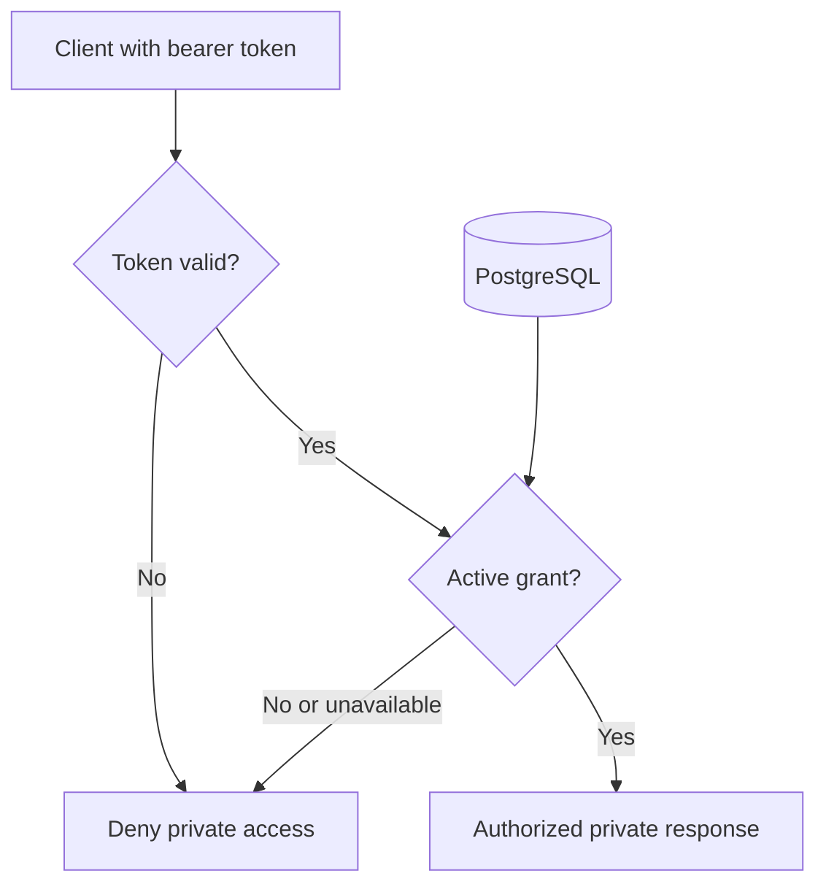
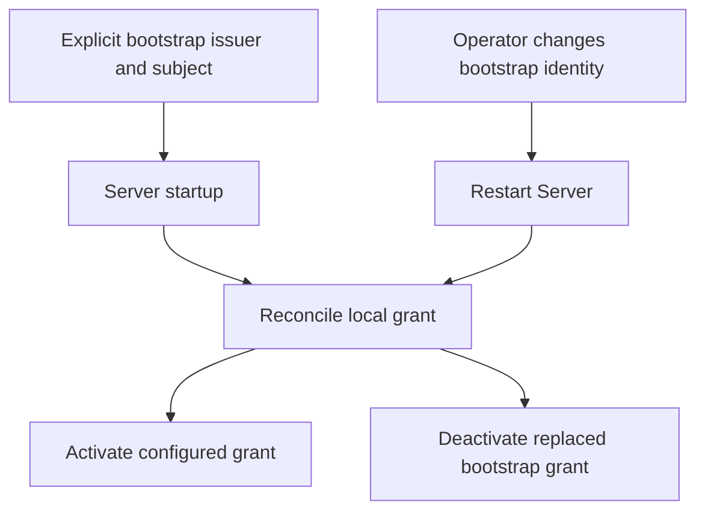
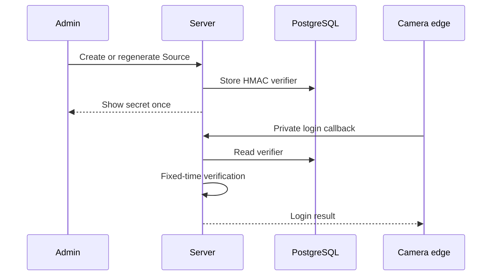
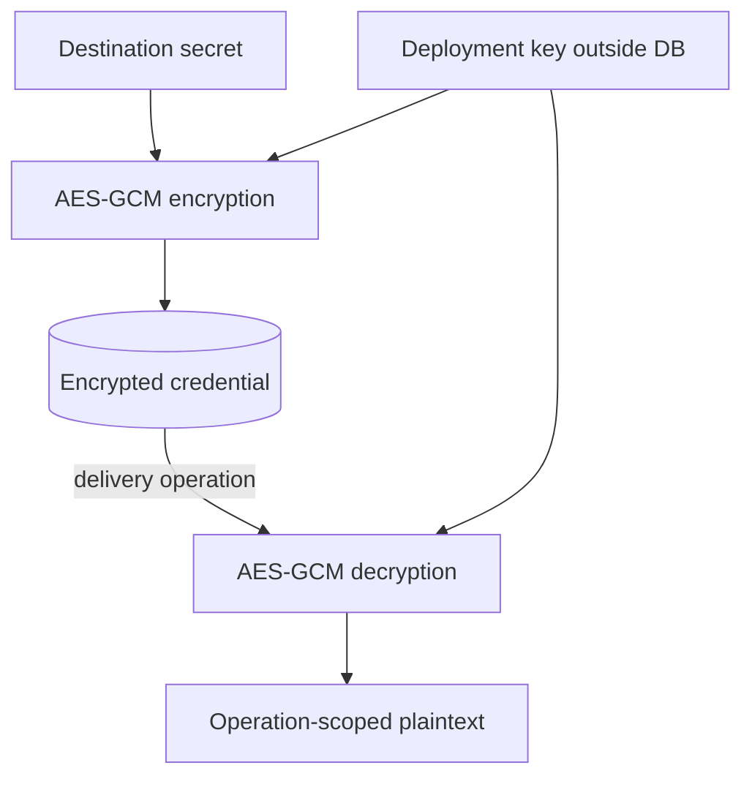

# Authentication and authorization

A valid sign-in and permission to use this deployment are separate decisions.
That lets an operator revoke local access without waiting for every previously issued token to expire.
The [Server reference](../../src/ShutterSpool.Server/README.md#local-security-configuration) owns concrete settings; this guide explains the implemented trust boundary.

## The short version

- An external OpenID Connect (OIDC) issuer authenticates a person. ShutterSpool does not store or check management passwords.
- The Server validates the issuer, audience, signature and expiry. Single-workspace mode additionally requires the `shutterspool-admin` token role; shared-workspace mode does not require that provider role.
- The Server then checks an active local grant in PostgreSQL, keyed by the token's stable issuer and subject. Both checks must pass before a management API, private preview/original, or live-status stream can return private data.
- PostgreSQL is the authority for grants and credential state. Valkey is not in the authorization path and cannot make stale or revoked access valid.

The web client is outside the trusted authorization boundary. It may hide or show controls, but it cannot authorize access; the Server does that for every protected request.

## Why there are two decisions

OIDC answers **who presented this token**, while a local grant answers **whether this person may currently access this ShutterSpool deployment**. Keeping those separate makes revocation and recovery local, without making ShutterSpool a password store or coupling media/workflow ownership to an identity-provider database.

| Decision | Authority | What it proves | Failure result |
| --- | --- | --- | --- |
| Authentication | Configured OIDC issuer, verified by Server | A token is from the allowed issuer, for this audience and unexpired; single-workspace mode also checks its coarse role. | No principal; protected endpoint returns no private data. |
| Authorization | PostgreSQL, checked by Server | The `(issuer, subject)` has an active ShutterSpool grant. | Access is denied, including if the database cannot make a safe decision. |

Keycloak is an identity provider here, not the owner of photographic permissions. It does not contain individual Assets, Captures, Routes, Destinations, or Delivery permissions. Those records and workspace grants remain ShutterSpool workflow truth in PostgreSQL.

## Protected request and revocation

Every protected HTTP request goes through both checks. A valid token alone is insufficient. This means an operator can be removed by deactivating the local grant even while the token would otherwise remain valid.

Signing metadata and keys come from the configured issuer as needed; token validation does not mean asking the issuer to authorize each photograph.
The Server verifies signature, issuer, audience and expiry, plus the coarse role in single-workspace mode, then reads the local grant before returning private data.

Live status is a long-lived exception only in transport, not in policy. The Server closes the hub connection at token expiry and rechecks its local grant every 30 seconds; a revoked principal therefore loses hub access at the next check. The legacy live-status event stream checks expiry and authorization every 60 seconds. A cache miss, stale cache entry, or lost cache invalidation notification must never preserve access.

## Bootstrap and recovery

Shared-workspace mode uses [explicit workspace provisioning](../../src/ShutterSpool.Server/README.md#shared-workspace-provisioning) to create its first local grant once, against a verified issuer/subject.
An ordinary restart never replays that grant or substitutes the deployment operator as a workspace member.
The following bootstrap reconciliation applies only to single-workspace mode.

In single-workspace mode, the first local grant is explicit deployment configuration: an issuer and subject that the operator has already established in the chosen IdP. On Server startup, that configuration is reconciled into PostgreSQL. Changing it and restarting replaces the prior bootstrap grant. There is no default password, automatic first-login enrollment, or unauthenticated recovery endpoint.

For an operator without an existing issuer, the supported profile supplies a Keycloak companion. Deployment secrets create its operational bootstrap and initial ShutterSpool administrator; versioned realm, client, role, and mapper configuration is reconciled without requiring a Keycloak-console visit. Keycloak’s own master administrator is deployment plumbing, not a ShutterSpool login.

The companion preserves the explicitly configured subject when provisioning a fresh administrator. For an existing exact username, reconciliation verifies its Keycloak ID against that subject and fails before password/role changes if they differ. Recovery corrects the deployment subject to the verified intended account and recreates the AppHost; it never replaces the existing account or enrolls an arbitrary first login.

## Workspace selection

In shared-workspace mode, a verified identity may discover only workspaces where it has a current local grant.
The URL selects the workspace for that browser page, and each API request carries its explicit workspace identity.
The Server resolves the tenant before checking that tenant's local grant; missing or invalid selection never falls back to another database.
Separate tabs can use separate workspaces under the same OIDC login, without a mutable global workspace session.
Switching workspaces reloads the page so selections, drafts, private previews and live subscriptions do not carry into the new scope.

The control registry grants no media access. Camera usernames are unique on the shared ingress endpoint and resolve through opaque routing handles, followed by current Source credential/generation checks inside the selected tenant.
Camera credentials grant only Source ingress and cannot establish human membership.

## Credentials and encryption

Management identity is not source ingress authentication. Each logical Source has its own generated or custom credentials and a distinct virtual ingress root; several devices may share that Source.
Source credentials cannot become management or destination credentials. A source secret is stored only as a fixed-time verifier, so it cannot be recovered.
Destination/provider credentials need recovery for delivery and are encrypted in PostgreSQL with AES-GCM.

### Source credentials: verify, never recover

This sequence shows generated credentials. Custom passwords are supplied by the operator and omitted from the response.

### Destination credentials: encrypt, recover only for delivery

The encryption key is a persistent deployment secret outside the database. It must accompany a backup/restore; a missing or mismatched key fails closed for the dependent operation. Secrets are never placed in Valkey, telemetry, logs, errors, or routine fixtures.
APIs return a generated Source password only at creation or explicit credential replacement; custom passwords are never returned, and stored passwords cannot be read back.

## Constraints for changes

- Put the final authorization check in `ShutterSpool.Server`, before returning private bytes, previews, configuration, or live data.
- Treat the client, preview service, cache, and identity-provider roles as supporting layers, never as an independent authorization authority.
- Keep local grants and credential state durable in PostgreSQL; tolerate cache loss safely.
- Preserve issuer and subject as the stable person reference. Do not make provider-specific identities durable owners of media or workflow records.
- Keep source credentials isolated by source and virtual root; do not reuse them for management or delivery.
- Redact credentials, token material, and private media locations while retaining non-secret audit information for successful and failed attempts.

## Current limits

Shared-workspace isolation is limited to one Server and separate tenant databases/filesystem allocations.
Delegated/team roles, public links, Keycloak UMA/object resources, external key management and key rotation are not implemented by this boundary.
Hosted processing, storage enforcement and recovery still need qualification for the selected deployment.
An external OIDC provider still needs the documented client, claim and local-grant configuration; discovery alone does not prove compatibility.

For concrete current configuration, see the [Server security configuration](../../src/ShutterSpool.Server/README.md#local-security-configuration).
