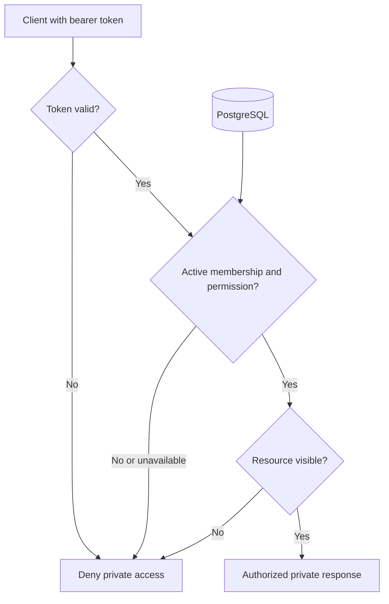
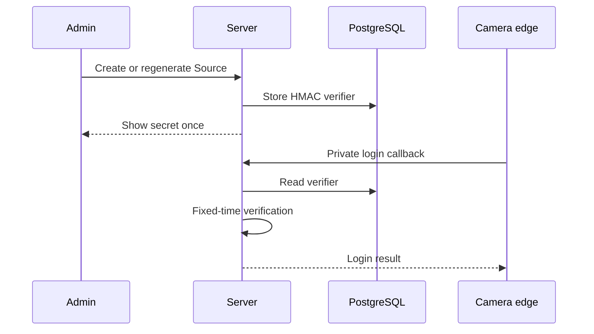
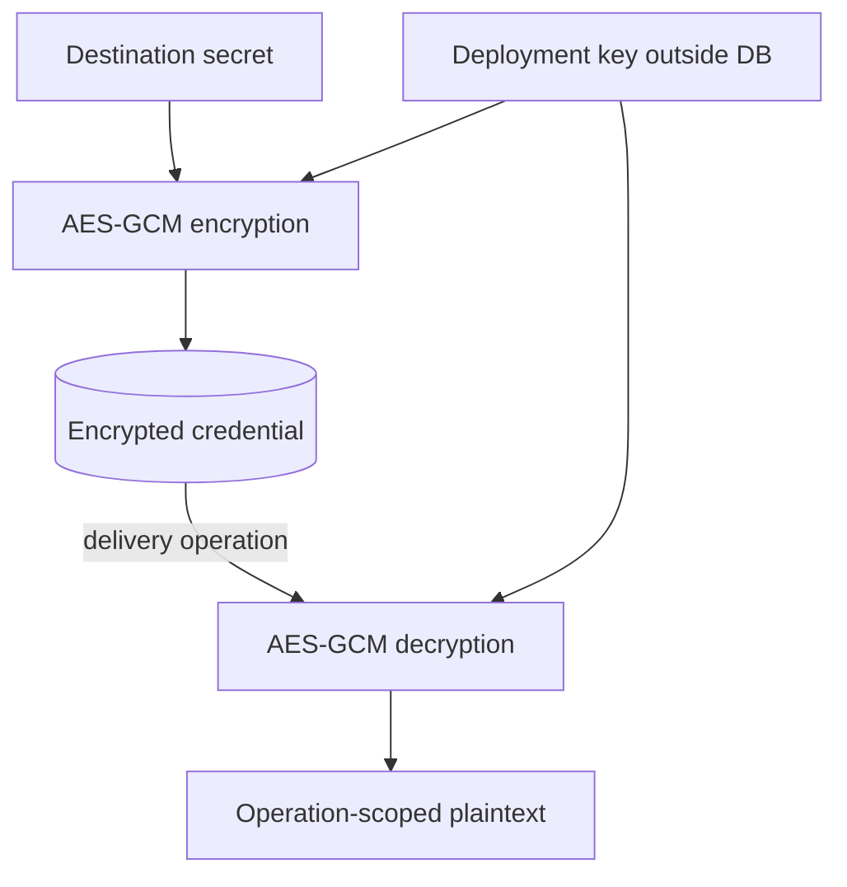

# Authentication and authorization

A valid sign-in and permission to use this deployment are separate decisions.
That lets an operator revoke local access without waiting for every previously issued token to expire.
The [Server reference](../../src/ShutterSpool.Server/README.md#local-security-configuration) owns concrete settings; this guide explains the implemented trust boundary.

## The short version

- An external OpenID Connect (OIDC) issuer authenticates a person. ShutterSpool does not store or check management passwords.
- The Server validates the issuer, audience, signature and expiry. Provider roles do not grant workspace access.
- The Server then checks an active local membership in PostgreSQL, keyed by the token's stable issuer and subject, and the permission required by the operation. Media reads also apply the member's current visibility scope.
- PostgreSQL is the authority for grants and credential state. Valkey is not in the authorization path and cannot make stale or revoked access valid.

The web client is outside the trusted authorization boundary. It may hide or show controls, but it cannot authorize access; the Server does that for every protected request.

## Why there are two decisions

OIDC answers **who presented this token**, while a local grant answers **whether this person may currently access the selected workspace**. Keeping those separate makes revocation and recovery local, without making ShutterSpool a password store or coupling media/workflow ownership to an identity-provider database.

| Decision | Authority | What it proves | Failure result |
| --- | --- | --- | --- |
| Authentication | Configured OIDC issuer, verified by Server | A token is from the allowed issuer, for this audience and unexpired. | No principal; protected endpoint returns no private data. |
| Authorization | PostgreSQL, checked by Server | The `(issuer, subject)` has an active membership with the required workspace permission and resource visibility. | Access is denied, including if the database cannot make a safe decision. |

Keycloak is an identity provider here, not the owner of photographic permissions. It does not contain individual Assets, Captures, Routes, Destinations, or Delivery permissions. Those records and workspace grants remain ShutterSpool workflow truth in PostgreSQL.

## Protected request and revocation

Every protected HTTP request checks current authority before private reads or command execution; independently committed bulk items each receive a fresh check.
A valid token alone is insufficient, and removing a local membership denies subsequent admission while the token would otherwise remain valid.
Already admitted work may finish and commit after revocation or a policy change returns. An admitted release can therefore still queue delivery.
Ordinary workflow transactions do not share an authorization lock with membership changes; existing lifecycle, revision and media-custody checks still apply.

Signing metadata and keys come from the configured issuer as needed; token validation does not mean asking the issuer to authorize each photograph.
The Server verifies signature, issuer, audience and expiry, then reads the selected workspace's current membership, permission and media visibility before returning private data.
Cached derivative bytes do not bypass admission, and personal filters cannot widen the authorized media query.

Live status is a long-lived exception only in transport, not in policy. The Server closes the hub connection at token expiry and rechecks its local grant every 30 seconds; a revoked principal therefore loses hub access at the next check. The legacy live-status event stream also checks expiry and authorization every 30 seconds. A cache miss, stale cache entry, or lost cache invalidation notification must never preserve access.

## Roles and access changes

The fixed Owner, Administrator, Curator and Viewer roles belong to each workspace membership.
The [user guide](../workspaces.md#understand-your-role) owns their capability comparison and Viewer visibility rules.
Named ASP.NET authorization policies attached to endpoints enforce workspace permissions; unclassified private operations deny access. Domain policies own pure role/access and media-visibility decisions; Infrastructure applies visibility predicates before projection and paging.
Operational/configuration diagnostics remain administrative. Nonadministrative media reads use safe outcomes without provider paths or raw attempt diagnostics.

Membership, Owner and Viewer-policy changes serialize in a short transaction inside the selected tenant database.
After acquiring that boundary, the operation rechecks the current actor, target role, expected revision and remaining active Owner count.
The change, operation result and audit commit together. An earlier request check cannot authorize a later access change after the actor loses that authority.
Owner promotion is a separate confirmed action; an Administrator cannot alter an Owner, and the last active Owner cannot leave or be removed/demoted.
These ordinary access changes retain operation UUIDs for retry reconciliation. Clients use the capability flags returned by the Server to gate controls; the Server remains authoritative.

## Bootstrap and recovery

[Explicit workspace provisioning](../../deploy/operations/README.md#workspace-provisioning) creates the initial Owner membership and its operator-attributed audit once, against a verified issuer/subject.
An ordinary restart never replays that grant or substitutes the deployment operator as a workspace member.
Initial provisioning works without SMTP or a verified email. There is no default password, automatic first-login enrollment or unauthenticated recovery endpoint.

Recover the same existing Owner identity through native IdP self-service or trusted administration, then use normal local Owner management. If no Owner identity is recoverable, a trusted application/database operator may repair the local grant as exceptional maintenance; there is no application recovery subsystem. See [Owner login recovery](../../deploy/operations/README.md#owner-login-recovery) for the operational boundary. Provider administration and attribution belong to the operator; a Server audit entry identifies the authenticated principal and does not prove which operator used IdP impersonation.

Member names are display-only claims cached when the member calls authenticated `GET /management/access`. Missing names fall back to the subject and may remain absent until that person accesses the workspace. There is no identity directory lookup, and names never authorize a grant.

For an operator without an existing issuer, the supported profile supplies a Keycloak companion. Deployment secrets create its operational bootstrap and initial ShutterSpool administrator; versioned realm, client and audience-mapper configuration is reconciled without requiring a Keycloak-console visit. Keycloak’s own master administrator is deployment plumbing, not a ShutterSpool login.

The companion preserves the explicitly configured subject when provisioning a fresh administrator. For an existing exact username, reconciliation verifies its Keycloak ID against that subject and fails before account changes if they differ. Correcting initial account setup requires the verified intended subject; it never replaces the existing account or changes an already provisioned workspace grant.

## Workspace selection

A verified identity may discover only workspaces where it has a current local grant.
When discovery is complete and exactly one workspace is accessible, a page without a selection opens it automatically. Explicit invalid/unavailable selections and incomplete discovery never trigger a fallback.
The URL selects the workspace for that browser page, and each API request carries its explicit workspace identity.
The Server resolves the tenant before checking that tenant's local grant; missing or invalid selection never falls back to another database.
Separate tabs can use separate workspaces under the same OIDC login, without a mutable global workspace session.
Switching workspaces reloads the page so selections, drafts, private previews and live subscriptions do not carry into the new scope.

The control registry grants no media access. Camera usernames are unique on the shared ingress endpoint and resolve through opaque routing handles, followed by current Source credential/generation checks inside the selected tenant.
Camera credentials grant only Source ingress and cannot establish human membership.

For browser requests, JWT authentication runs first. `WorkspaceSelectionMiddleware` resolves and binds the requested workspace before endpoint authorization reads that tenant's current membership and permissions.
This order is required because the grant store itself needs the selected tenant database. A valid selector alone grants no access.

`WorkspaceIngressMiddleware` handles private camera callbacks instead: it checks the private listener and callback key, reads the bounded routing identity, then binds the workspace found in the control registry.
The camera endpoint subsequently validates the Source credential or durable admission. Routing does not revoke an already admitted transfer when credentials change.

`WorkspaceLiveTokenMiddleware` binds SignalR negotiation tokens to the selected workspace using data protection, and unwraps them before native SignalR transport handling.
SignalR knows its connection token, but not ShutterSpool's workspace boundary; the wrapper prevents polling a connection under another selected workspace.
Token expiry and current membership/visibility checks remain separate responsibilities.

## Credentials and encryption

Management identity is not source ingress authentication. Each logical Source has its own generated or custom credentials and a distinct virtual ingress root; several devices may share that Source.
Source credentials cannot become management or destination credentials. A source secret is stored only as a fixed-time verifier, so it cannot be recovered.
Destination/provider credentials need recovery for delivery and are encrypted in PostgreSQL with AES-GCM.

### Source credentials: verify, never recover

This sequence shows generated credentials. Custom passwords are supplied by the operator and omitted from the response.

### Destination credentials: encrypt, recover only for delivery

The encryption key is a persistent deployment secret outside the database. It must accompany a backup/restore; a missing or mismatched key fails closed for the dependent operation. Secrets are never placed in Valkey, telemetry, logs, errors, or routine fixtures.
APIs return a generated Source password only at creation or explicit credential replacement; custom passwords are never returned, and stored passwords cannot be read back.

## Constraints for changes

- Authorize request admission in `ShutterSpool.Server`; access-changing operations also recheck current authority inside their atomic tenant update.
- Treat the client, preview service, cache, and identity-provider roles as supporting layers, never as an independent authorization authority.
- Keep local grants and credential state durable in PostgreSQL; tolerate cache loss safely.
- Preserve issuer and subject as the stable person reference. Do not make provider-specific identities durable owners of media or workflow records.
- Keep source credentials isolated by source and virtual root; do not reuse them for management or delivery.
- Redact credentials, token material, and private media locations while retaining non-secret audit information for successful and failed attempts.

## Current limits

Shared-workspace isolation is limited to one Server and separate tenant databases/filesystem allocations.
Custom roles, individual Viewer rules, public links, Keycloak UMA/object resources, external key management and key rotation are not implemented by this boundary.
Hosted processing, storage enforcement and recovery still need qualification for the selected deployment.
An external OIDC provider still needs the documented client, claim and local-grant configuration; discovery alone does not prove compatibility.

For concrete current configuration, see the [Server security configuration](../../src/ShutterSpool.Server/README.md#local-security-configuration).
