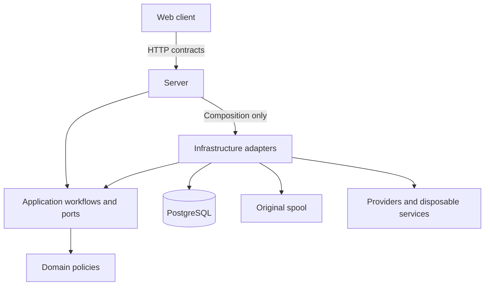

# System boundaries and domain map

ShutterSpool is a modular monolith: one product runtime with clear internal responsibilities, not a service per feature folder.
The boundaries exist to keep responsibility for a photograph understandable when cameras disconnect, providers time out or the process restarts.
Read [a photograph's journey](../core-workflow.md) next for the end-to-end behavior.

## Authority and dependency direction

Original bytes and workflow truth have different homes.
The spool owns the bytes; PostgreSQL records what was accepted and what may happen next.
A cache can make a read faster, but losing it must never lose a photograph or turn an uncertain operation into success.

| Boundary | Owns | Why it is separate |
| --- | --- | --- |
| PostgreSQL | Assets, Captures, curation, routing, delivery and recovery/retention evidence | Restart must preserve decisions, not reconstruct them from notifications. |
| Spool | Immutable original bytes and recoverable ingest custody | File presence alone cannot prove an accepted Asset; a database row alone cannot supply its bytes. |
| Valkey | Disposable cache and wakeups | Acceleration must not become a second workflow authority. |
| Imaginary / preview cache | Regenerable derivatives | A broken thumbnail service must not stop ingest, release or delivery. |
| Protocol edge | Wire protocol and source session | Protocol success must follow jointly recoverable bytes and Asset state. |
| Server and clients | Authorized commands, reads and interactions | A browser projection cannot grant access or invent a durable outcome. |

The code dependencies preserve that separation:

Arrows here mean code dependencies, not the order in which a photograph moves.
Domain has no adapter dependencies.
Application coordinates use cases and defines ports; Infrastructure implements them.
Server owns endpoint-local DTOs, authorization and hosted scheduling; only its Composition area references Infrastructure.
OpenAPI generates the frontend client, so Domain/Application records do not become accidental wire contracts.

[AppHost](../../src/ShutterSpool.AppHost/README.md) wires the development resources; [ServiceDefaults](../../src/ShutterSpool.ServiceDefaults/README.md) supplies host health and telemetry conventions.
The [source map](../../src/README.md) links the six .NET projects and Nuxt application.
The AppHost generates the [Compose candidate](../../deploy/README.md), which packages these existing runtime components and static Web output with upstream services.
It introduces no additional application layer. Generated candidates retain explicit platform/dependency limits and do not imply a published release.

FTPS cipher negotiation belongs to the edge, before Source authentication.
The optional legacy edge therefore has a separate listener and trusted private authentication route;
Application/Infrastructure retain the trusted listener profile in login context and enforce the Source's single persisted profile at authentication and admission.
Profile edits are revision guarded, advance credential generation and require reconnecting without rotating the secret.
Deployment capabilities govern availability; removing a capability retains saved settings/media and blocks new admission.
The browser presents General, Connection and Security settings plus configured public CA-root downloads.
Each enabled edge shares Server's durable ingest/admission boundary; FTPS edges share certificate lifecycle while the modern listener retains its cipher defaults.

## Domain vocabulary

A RAW+JPEG shot is a useful example: two **Assets**, one **Capture**, and potentially several **Deliveries**.
Grouping makes the photograph convenient to curate; it does not merge the original identities or delete a duplicate-looking file.

| Concept | Meaning |
| --- | --- |
| Source | Configured origin and its ingress/curation policy. A source credential is separate from a person's login. |
| Asset | One immutable accepted original, with independent identity, byte evidence and provenance. |
| Capture | A logical shot grouping Assets, with shared curation and release lifecycle. |
| Collection | One named organizational home per Capture, with stable identity, Source-selected incoming defaults and separately frozen release context. It does not own original storage or retention policy. |
| Variant | An Asset's role within a Capture; a JPEG variant is still an original, not a preview. |
| Preview | A disposable derivative for browsing authorized media. |
| Route | Conditions and destination actions evaluated against a release snapshot. |
| Destination | A configured target with provider-specific publication and conflict semantics. |
| Delivery / Attempt | Durable work for an Asset and recorded target / one execution and its evidence. |
| Retention | Policy and protections governing when original bytes may leave the spool. |
| External provenance | Provider/connection/resource identity used for reconciliation and loop prevention where supported. |

These are product concepts, not instructions to introduce a table or abstraction for every noun.

## Why these boundaries matter

### Acceptance is a promise about bytes and state

A camera can stop retaining responsibility after upload success.
ShutterSpool therefore acknowledges only after original bytes and authoritative Asset state are durable and jointly recoverable.
Grouping, previews, curation, routing and delivery happen afterward; their availability cannot gate that acknowledgement.
See the [acceptance sequence](../core-workflow.md#1-accept-responsibility-before-saying-success) and [durable ingest reference](../../src/ShutterSpool.Infrastructure/README.md#durable-ingest).

### Durable decisions outlive today's configuration

Release freezes the curation and routing configuration used to create work.
A later rule edit must not rewrite why yesterday's photograph was sent.
Claims and recorded outcomes live in PostgreSQL; provider I/O runs outside transactions and reports the evidence the provider can actually support.
The [delivery reference](../../src/ShutterSpool.Infrastructure/README.md#destination-delivery-boundaries) distinguishes provider operations from work ownership.

### Disposable services can disappear

Workers scan PostgreSQL even if a Valkey wakeup is missed.
Live clients reread authorized state after hints, reconnects and periodic reconciliation.
Previews can be regenerated while an accepted source remains available.
None of these conveniences can prove delivery, authorize deletion or keep a revoked person authorized.

### Storage recovery must be deliberate

Retention evaluates individual Assets but ordinary automatic cleanup moves whole eligible Captures to recoverable Trash.
Protection, active original use and exact removal authority matter independently of age or pressure.
Unknown storage and an expired worker lease cannot prove removal.
Read [retention](../retention.md) for the policies and [authentication](authentication-and-authorization.md) for access and secret custody.

## Persistence and atomic operations

### Shared workspaces

Shared-workspace mode keeps one Server and a separate PostgreSQL database and allocated storage root for each workspace.
The control database resolves workspace identities, provisioning state, fixed allocations and opaque camera routing handles; it contains no media or authoritative membership grants.
Each tenant database retains the existing workflow schema, local grants, reservations and recovery state under its own restricted runtime credentials.

Requests and worker passes bind an immutable workspace context before resolving database, filesystem or authorization services.
Missing, invalid or unavailable context fails closed; it never selects a default tenant.
The browser's workspace URL is a selection request, and the Server still checks current membership.
Private previews, caches and live fanout carry the same workspace identity.

Workers retain their distinct responsibilities and cycle through tenants with bounded work per turn.
Slow delivery and preview work use bounded shared slots; no permanent worker stack or service provider is created per tenant.
The current limits are 32 registered workspaces and four pooled connections per workspace, with no minimum idle pool.
These are resource bounds, not throughput or availability guarantees.

The operator provisions fixed filesystem-enforced allocations whose total fits usable capacity after reserves and other host data.
Tenant-local durable reservations enforce the workspace quota within that allocation; unused capacity cannot be borrowed from another workspace.
There is no shared host-reservation ledger or automatic storage allocator.
See [workspace configuration and provisioning](../../src/ShutterSpool.Server/README.md#shared-workspace-provisioning) and the [maintenance guide](../../deploy/operations/README.md).

### Workflow transactions

Operations often cross a database/filesystem boundary that cannot be one transaction.
The implementation keeps exact identity and recovery evidence across those steps, then rechecks authority when concurrent operations compete.
Use the [persistence and recovery reference](persistence.md) before changing locks, save points, original-use fencing or startup recovery.
It preserves the precise implementation constraints without making them the first architecture lesson.

## Extension recipes

| Change | Owner and steps | Required checks | Prohibited dependencies |
| --- | --- | --- | --- |
| Business rule | Add a typed policy/input/result in Domain; invoke it from the existing Application workflow or locked persistence operation. | Core edge cases; PostgreSQL concurrency if affected; architecture tests. | Domain cannot reference JSON, EF, hosting, transport or providers. |
| HTTP operation | Add named DTOs and explicit mappings beside Server/Api endpoints; call an Application service and enforce authorization; describe success/400/404/409 as applicable. | Authorized and rejected requests, redaction/conflict state, OpenAPI and deterministic Kiota regeneration. | Endpoints cannot access Infrastructure or expose core/persistence types as DTO members. |
| Destination adapter | Implement Application's write/reconciliation port, resolve provider configuration in Infrastructure, and register its explicit kind in composition. Duplicate kinds fail startup. Local and WebDAV are implemented. | Provider failure/uncertain outcome/cancellation/idempotency tests and unchanged delivery policy tests. | Provider adapters cannot own claims, retries, target reservations or durable completion. |
| Persistence change | Change internal feature entities/mappings/atomic operations; add a migration to the single history. Review affected locks and save points. | Real PostgreSQL migration/restart/concurrency checks and no pending EF model changes. | No Server persistence, public EF entities, generic repository or provider I/O inside transactions. |

## Stream and deployment boundaries

Changes must preserve the ownership, acknowledgement and recovery constraints above.
Use the request, source and relevant tests together when reviewing behavior.

Original streams remain behind Application ports with opaque references; consumers cannot assume a local path or a seekable stream.
That replacement boundary matters even though object storage and multi-node placement are not implemented.
A worker claim or preview-ready hint does not establish access to another node's disk.
The runtime uses one Server and filesystem storage, with optional shared-workspace isolation.
It does not implement object storage, multi-node placement or mobile offline synchronization.
Database separation does not isolate tenants from a compromised shared application or privileged host, and local checks do not qualify a hosted service.
