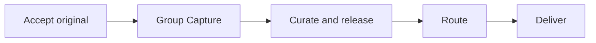
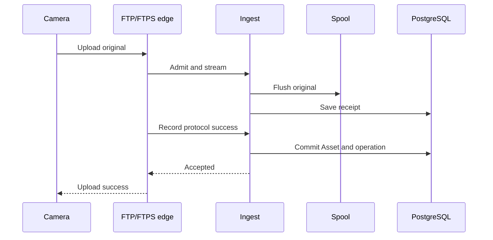
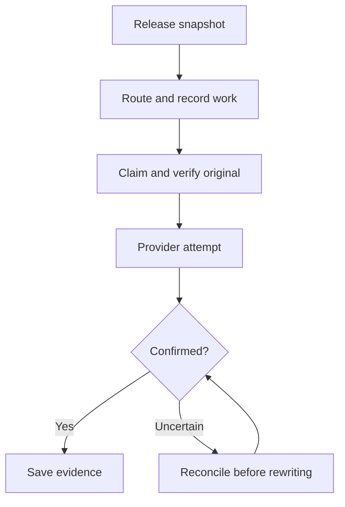
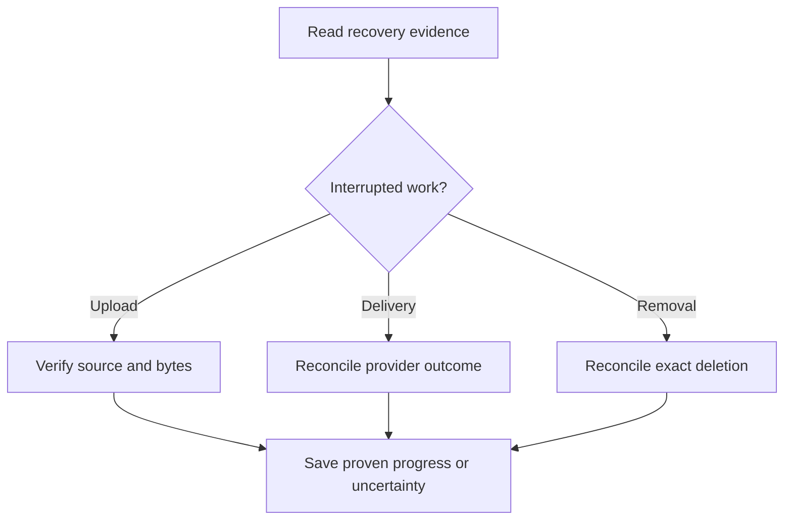

# A photograph's journey

Imagine shooting a RAW+JPEG pair and sending both files from the camera.
ShutterSpool keeps two independent originals, groups them as one Capture when the evidence is clear, and lets you decide what should leave for each destination.
That distinction—bytes, a photographic decision, and delivery work—is the thread through the code.

This is a developer guide to the implemented workflow. For camera-user instructions, start with [camera setup](camera-compatibility.md#camera-setup).

The current runtime supports camera ingress through explicitly enabled SFTPGo edges, local and WebDAV destinations, and the web workspace.
Standard FTPS is the recommended encrypted profile; legacy FTPS compatibility and unencrypted trusted-LAN FTP require explicit selection.
See [camera compatibility](camera-compatibility.md) for actual hardware evidence; this guide makes no claim for other protocols or native mobile clients.

This is the workflow order, not a chain the camera has to wait for.
Only durable acceptance gates upload acknowledgement.
[Retention](retention.md) runs alongside the workflow and controls how long original bytes remain available.

## 1. Accept responsibility before saying success

The protocol edge handles FTP/FTPS; it does not own original storage or decide when an upload is safely accepted.
Application coordinates admission and ingest, Infrastructure streams into the private spool, and PostgreSQL records the operation and Asset.
Streams use bounded buffers so a large photograph does not become a large in-memory object.

A byte receipt alone is insufficient for camera publication: the matching successful protocol event must also be recorded.
This avoids mistaking an interrupted receive for an accepted photograph.
It does not independently establish the file length the camera intended to send: a clean early EOF can still produce a truncated Asset.
The [camera guide](camera-compatibility.md#sony-α7c-ftp-settings-and-retransfers) records that observed limit.

Retrying the same completion callback returns its recorded result.
Sending the entire photograph again creates another Asset, even if its filename and bytes match.
Identity describes an accepted upload, not a filename or a hash.

If a connection or process fails, recovery checks durable correlation and byte evidence before publication.
Unproven bytes stay private or quarantined with a reason; recovery does not guess that a file's presence means success.
See the [spool recovery reference](../src/ShutterSpool.Infrastructure/README.md#durable-ingest) for exact states and the separate, currently unwired `AcceptAsync` path.

## 2. Group a shot without losing its originals

Metadata extraction runs after acceptance and leaves originals untouched.
It supplies camera identity, capture-time evidence and variant roles to conservative grouping rules.
Unknown time zones remain unknown; the host's local clock does not repair missing camera evidence.

A uniquely compatible RAW and JPEG can share one Capture.
Ambiguous matches stay separate, and recognized replays remain related independent Assets rather than replacing the earlier original.
Grouping does not wait for a JPEG, preview or pairing timer.
Later complementary files can join an eligible Active Capture; removed Captures are excluded, and Restore does not retroactively merge newer Captures.

For developers, the useful separation is **Domain decides compatibility; Infrastructure applies it to locked evidence**.
Matching requires a unique compatible embedded-shot relationship, including variant role, camera identity and timestamp precision.
Contradictory or insufficient identity/time evidence cannot establish a pair. Existing memberships and delivery history are not automatically rewritten.

Grouping also assigns each new Capture to the Source's current default Collection, atomically with Capture creation.
Already accepted uploads awaiting grouping can follow a later default; existing Captures do not.
A complementary or replayed Asset joining a Capture follows its current membership rather than the Source's new default.
The [Collection guide](collections.md) explains setup, browsing and explicit moves.

## 3. Let the photograph lead curation

Source policy chooses Immediate, Delay or Manual release.
Immediate skips the review delay; Delay allows a shooting-time review window; Manual waits for an explicit decision.
A Capture shares rating, color and tags across its variants.
The signed rating represents Reject, neutral/unrated and one to five stars; selection is derived from it.
Hold pauses release. Reject alone does not delete bytes or impose Hold.

Release freezes the curation, routing configuration and Collection ID/name/path used for that decision.
This lets a developer explain an old delivery even after someone edits today's rules.
The web UI keeps released curation read-only; the server's versioned current-curation policy is separate from that interaction choice and never rewrites the release snapshot.
Favorite is another independent action: its storage consequences belong in the [retention guide](retention.md#favorites-and-other-protections).

Previews make review comfortable, but they never decide whether ingest, release or delivery can proceed.
The current preview source is the primary JPEG; RAW-only Captures can show a placeholder.
Imaginary receives selected bytes over a private connection, without a spool mount or arbitrary remote-image fetching.
Derivatives are disposable and can regenerate while an accepted source remains available.

## 4. Route a decision, then deliver with evidence

Routing evaluates the frozen release configuration and records decisions, targets and delivery work.
No matching route is different from a technical failure.
It is also not proof that an original is safely disposable.

Delivery is at least once, with recorded targets and explicit conflict handling.
The worker owns durable claims/retries; a provider adapter owns the write and the evidence it can honestly return.
Slow provider I/O happens outside database transactions.
Valkey may wake a worker sooner, but PostgreSQL scanning still finds work after a missed signal.

Confirmation is provider-specific: local delivery verifies by read-back; WebDAV can confirm completed publication acknowledgement, use a stored provider checksum receipt, or fall back to read-back during reconciliation.
These evidence levels are recorded separately; a provider receipt is not independent stored-byte verification.
A missing target after an uncertain write does not automatically permit another write.
The [destination reference](../src/ShutterSpool.Infrastructure/README.md#destination-delivery-boundaries) explains the exact guarantees and limits.

Retry uses recorded targets; Resend and Reevaluate are explicit actions with their own confirmation rules.
They do not silently reinterpret historical success when rules change.
Automatic late-Asset routing keeps Collection facts frozen at release; explicit Reevaluate uses current membership and name/path.
A move or rename invalidates an earlier Reevaluate preview, while Retry/Resend retain the recorded target.
Pre-Collection releases remain explicitly Collection-not-recorded rather than acquiring invented historical values.
COMPLETE concerns required deliveries; [Favorite qualification](retention.md#default-lifetimes-and-clocks) is stricter and includes optional intended work.

## 5. Recover without inventing a happy ending

A crash between a file operation and its database update is a normal recovery case.
The system keeps enough identity and progress to reconcile that boundary; it never treats a worker timeout, lost cache or unavailable volume as successful completion.
Original-use fencing also keeps cleanup from deleting bytes beneath readers or active delivery.
Restore from Trash preserves history but leaves release/delivery paused until explicit Resume or Retry.

The browser follows the same principle at a smaller scale.
SignalR hints say that something changed; authorized reads establish what changed.
Reconnect and periodic reconciliation recover missed hints without replaying destructive commands or discarding curation drafts.
Lost mutation responses require an authoritative reread, not an automatic command retry.

## Find the code for your change

| Change | Start here |
| --- | --- |
| Grouping, routing, completion or lifetime rule | [Domain](../src/ShutterSpool.Domain/README.md), then its Application caller |
| A workflow or recovery operation | [Application](../src/ShutterSpool.Application/README.md), then its persistence/adapter ports |
| Byte storage, PostgreSQL or provider behavior | [Infrastructure](../src/ShutterSpool.Infrastructure/README.md) and [persistence constraints](architecture/persistence.md) |
| HTTP, authorization or background scheduling | [Server](../src/ShutterSpool.Server/README.md) |
| Curation interactions and live reconciliation | [Web](../src/ShutterSpool.Web/README.md) |

Use the [test guide](../tests/README.md) to choose evidence that matches the claim.
Pure policy tests explain decisions; real PostgreSQL/filesystem checks prove persistence and recovery boundaries.
