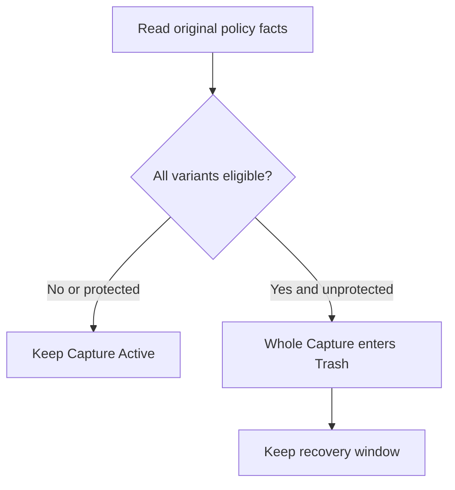
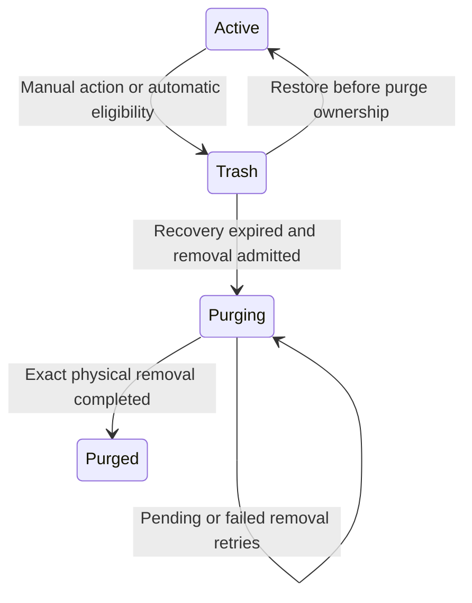
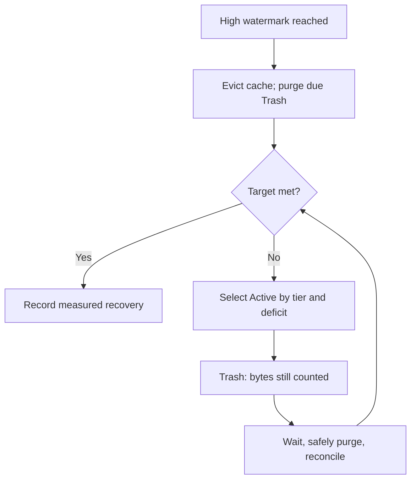
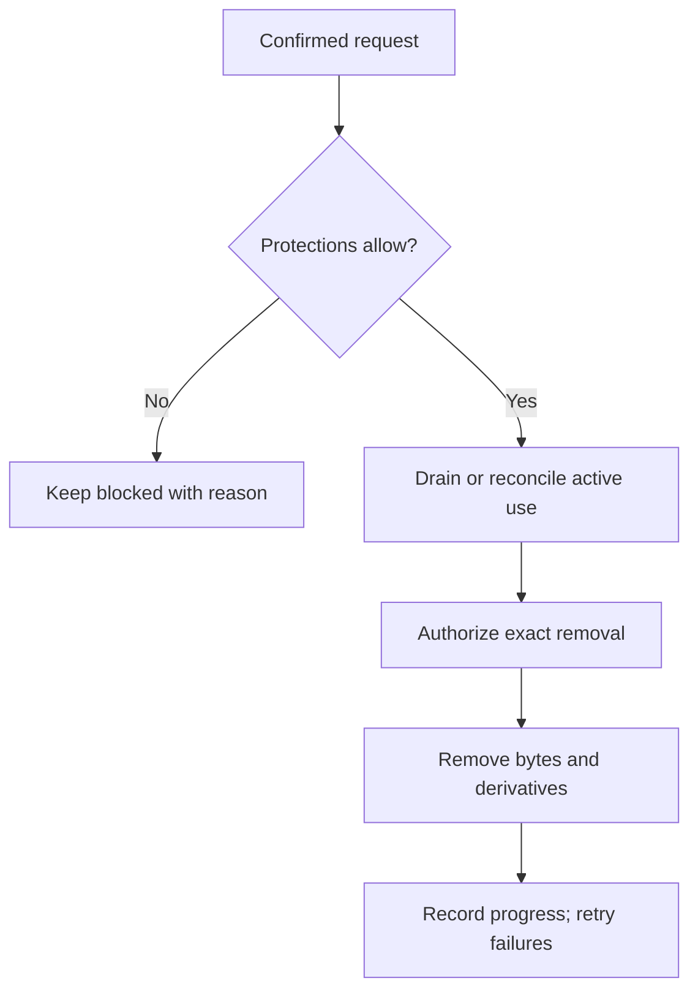

# Retention policies and storage recovery

ShutterSpool keeps camera originals temporarily, delivers them, and reclaims spool space under an explicit retention policy.
For everyday use, start with lifetimes, Favorites and Trash/Restore below. Operators also need the storage-pressure, policy and erasure guidance before changing Settings.
This guide explains implemented retention and Storage settings.
The policy and Settings interactions below describe the current implementation; eligibility is separate from physical deletion.
The design balances two needs: originals should not fill the spool forever, and an accepted photograph must not disappear through an implicit decision.
Eligibility, protection, recovery and physical removal are therefore separate facts.
Read the [core workflow](core-workflow.md) for how originals reach this point.

Settings → Storage contains shared policy and capacity controls; Curation and the owner Gallery show Favorites and retention information, while Trash contains recoverable Captures.
Gallery-only viewers cannot change Favorites, Trash or storage policy.

## What makes a Capture eligible?

A Capture groups original Assets, such as a RAW and JPEG pair.
Policy clocks and delivery evidence belong to each Asset, but automatic cleanup moves the **whole Capture** to Trash only when every available original qualifies and no protection blocks it.
A younger or protected JPEG can therefore keep its older RAW sibling longer.
An eligibility deadline is the earliest possible transition, not a scheduled deletion time.

Unknown or quarantined bytes are excluded from automatic selection and still occupy space.
Unexpectedly missing originals are recovery incidents.
An empty delivery list, lost cache, missing telemetry or Capture COMPLETE never proves that deletion is safe.
An explicitly enabled finite policy can eventually select media even when delivery has not succeeded.

## Default lifetimes and clocks

These are configurable defaults for original retention.
“Pressure” means the earliest selection under storage pressure; “ordinary” means eligibility without pressure.
Both lead to Trash before automatic permanent removal.

| Asset category | Pressure eligibility | Ordinary Trash eligibility | Clock starts at |
| --- | --- | --- | --- |
| Every intended delivery confirmed | 1 hour | 24 hours | Final intended delivery confirmation |
| Explicit No delivery intended | 24 hours | 7 days | Durable acceptance |
| Ordinary waiting or unmatched | 24 hours | 7 days | Durable acceptance |
| Held or any intended delivery unfinished | 14 days | 180 days | Durable acceptance |
| Favorite with every intended delivery confirmed | 1 hour | No age expiry | Final intended delivery confirmation |

“Every intended delivery” includes optional destinations.
COMPLETE uses the existing required-delivery rule, so a COMPLETE Capture can still have unfinished optional work and remain in the longer finite category.
No matching route is informational; a routing or delivery failure is a separate actionable condition.
Recording No delivery intended cannot cancel existing delivery obligations or manufacture successful delivery.

Lifetime changes apply to newly accepted Assets.
Existing Assets retain their policy revision and original clocks, including when they change categories; there is no bulk retiming.
Manual Trash or confirmed permanent deletion provides an explicit action for existing media.

Recognized replays use durable logical-variant relationships and positive delivery evidence.
A confirmed replay's residence clock starts at the later of its own acceptance and the applicable final confirmation; it does not renew sibling clocks.
Unfinished or ambiguous replay suppliers use their own finite held/unfinished interval, and active supplier use blocks incompatible removal.

## Favorites and other protections

The heart records retention intent independently of stars, Pick/Reject, labels, release and routing.
Saving or removing a heart does not send media, Hold it or reevaluate routes.
Reject alone neither deletes nor Holds media; already released work keeps its delivery obligations.

A Favorite has no ordinary age expiry only when every intended delivery is positively confirmed and the intended set is nonempty.
It **can still enter Trash under pressure** after its pressure minimum.
An incomplete Favorite keeps a finite policy.
If a previously exempt Favorite becomes incomplete, its first durable loss of qualification starts one fresh held/unfinished interval, defaulting to 14/180 days; duplicate commands and retries do not renew it.

Removing Favorite immediately returns the originals to ordinary eligibility, which may already be overdue.
There is no extra unfavorite grace period, but automatic movement still grants the full Trash recovery window.
A heart cannot recover bytes already removed, and a late save cannot override a transition already owned by Trash or purge.

| Protection | Effect | How it ends |
| --- | --- | --- |
| Curation Hold | Pauses release; finite held policy still applies | Curation action; no indefinite storage promise |
| Trash recovery | Retains recoverable originals, default 72 hours | Frozen deadline reached; purge must still pass safety checks |
| Restore protection | Blocks automatic age/pressure selection, default 72 hours | Authoritative deadline reached |
| Gallery availability promise | Protects explicit available original membership; default maximum 30 days | Accepted promise expires; extensions need fresh admission |
| Preservation hold | Blocks incompatible removal, including privacy erasure | Explicit release/resolution; a review date is only a reminder |

Gallery protection applies to admitted existing originals, with availability checked before commitment.
Revoking viewer access does not shorten that storage promise, and future uploads are not implicitly included.
Protection expiry only removes a blocker: underlying policy must still authorize cleanup.
These protections survive restart and cache loss, occupy the existing quota without a second copy, and can block new ingest.
They guarantee retention against cleanup, not redundant storage or uptime.

## Trash, Restore and Resume

Trash is a logical state: originals remain in place and continue counting toward quota.
Captures in Trash disappear from normal Curation and Gallery, and cannot receive new grouping/replay attachments, routing work, delivery claims or preview prewarming.
Owners can still preview/download recoverable originals.

This diagram shows the ordinary recovery path; separately confirmed permanent deletion is described below.
Trash entry freezes scope, reason, policy revision, delivery evidence and the recovery deadline.
The default window is **72 hours from durable entry**; retries, policy edits and storage pressure cannot restart or shorten it.
At expiry, purge becomes eligible rather than already completed.
Purging is not presented as recoverable once irreversible removal has begun; partial or failed removal remains visible and counted until bytes are actually removed.

Restore preserves Capture/Asset identities, Favorite, curation, release snapshot and delivery history.
It grants the default **72 hours of automatic age/pressure protection**, without resetting the original policy clocks; retrying the same Restore does not extend it.
After protection expires, policy is evaluated again and an overdue Capture may return to Trash.
Restore does not free space and can leave ingest blocked.

Restored release and unfinished delivery stay paused until an explicit Resume or Retry.
Resume continues eligible existing work; Retry retains recorded targets, while Resend/Reevaluate retain their own confirmation rules.
Confirmed deliveries do not automatically repeat.
Later uploads follow normal eligible-Active grouping or create a new Capture with fresh acceptance clocks; restoring an older Capture does not merge them retroactively.

## Quota pressure and admission

The quota is an admission budget, not a promise that the controller can always find something safe to delete.
That is why protected Trash can stop new uploads even while its eventual reclamation is already planned.

One shared spool cap counts Active originals, Trash, upload/transient bytes, quarantine, disk previews and the unwritten remainder of incoming reservations.
Written upload bytes count once.
Favorites and protected bytes are overlapping subsets, not extra occupancy.
PostgreSQL, RAM-only previews and delivered/downloaded copies are outside this cap; filesystem free-space reserve remains a separate constraint.

In **Settings → Storage**, the capacity ring separates Photographs, Trash, Disk previews, Temporary / quarantined files, Reserved space and Remaining allowance.
The segments do not overlap; Favorites, protected usage, planned reclamation and historically purged bytes appear separately in **Storage details**.
Point to, focus or tap a category to highlight its segment and explanation; every amount remains visible without highlighting.

Remaining allowance accounts for usage and ongoing reservations under the saved limit; it is not guaranteed free disk space.
Above the limit, remaining allowance is zero and the excess is shown separately; without an active limit, the ring shows usage and reservations only.
Unknown or inconsistent accounting is unavailable rather than zero, and stale observations are labeled **Last known** with their observation time.

The controller starts at a high watermark and reclaims toward a lower target, with `0 < recovery target < high watermark <= quota`.
Eligible Active Captures are selected in this order:

1. Ordinary, fully confirmed deliveries.
2. Explicit No delivery intended.
3. Fully confirmed Favorites.
4. Ordinary waiting/unmatched media.
5. Held or unfinished media.

A mixed Capture uses its most protective member tier and the latest eligibility boundary across its available variants.
Within a tier, the oldest common boundary comes first, with a stable tie-break; stars and file size do not change priority.
Selection covers only the target deficit and accounts for bytes already awaiting reclamation in Trash.

**Moving to Trash frees no space.**
Pending reclamation cannot fund another acknowledged upload, and the controller does not keep emptying Gallery while selected Trash waits for protection to expire.
Unknown accounting blocks new reservations until reconciliation; unavailable storage, protected occupancy and failed cleanup can also block admission.
Capacity reports show simultaneous blockers and the next known possible purge deadline, without promising when ingest will resume.

Incoming capacity is reserved before acknowledgement; accepted ingest still requires durable bytes and authoritative Asset state.
It does not wait for cleanup, grouping, previews or delivery.
When safe space is unavailable, new admission pauses or fails instead of breaking a protection promise.

## Settings and safe activation

Automatic original removal defaults to disabled.
Existing installations need an explicitly chosen active shared quota and acknowledgement of the settings impact before enabling it.
Open **Settings → Storage** to inspect capacity, preview the proposed impact and save with the current revisions; incomplete impact evidence cannot enable automatic cleanup.
The header Settings control opens Workspace first; **Storage settings** in Trash opens Storage directly.

For first-time setup:

1. Open **Settings → Storage**, select **Use a storage limit for new photographs** and set the limit and cleanup thresholds. Leave **Allow automatic cleanup** off.
2. Choose **Review changes**, read the changed values and their effects, acknowledge the impact, then **Save settings**. Quota-only activation can be saved with incomplete accounting; uploads may remain paused while usage is checked.
3. Choose **Refresh capacity** and inspect **Storage details** until usage is confirmed. If usage remains unknown, check that the configured spool root is available and matches this installation; a new **Checked** timestamp alone does not confirm accounting.
4. If you want automatic cleanup, enable it after the saved limit is active and usage is confirmed. Review the changes again, acknowledge the impact and save; this review must be complete.

Refresh preserves unsaved edits. Capacity can refresh even if saved settings could not be checked, but saving stays blocked until both reads succeed.
If settings changed elsewhere, use **Reload saved settings** before reviewing again.

**Review changes** opens a separate step showing only changed fields, their previous and proposed values, and what those changes mean.
The capacity ring describes the saved configuration; **Allowance after proposed limit** compares current usage and reservations with your draft limit.
An excess means new uploads can pause after saving. An inactive proposed limit or unknown accounting has no confirmed allowance estimate.
**Eligible now**, planned movement to Trash and planned reclamation describe different stages; incomplete movement or reclamation plans remain unknown instead of appearing as zero.
Use **Back to editing** to keep your draft and return to the editor position, then review again after editing.
There is nothing to review until a value changes, and **Save settings** saves the reviewed draft.

Quota enforcement and automatic original removal have separate controls.
Quota-only activation can adopt existing occupancy while accounting is incomplete; automatic removal remains off and admission may stay blocked until reconciliation.
A confirmed lower quota applies immediately, even when current occupancy exceeds it.
Admission may block while accepted Trash, Restore, gallery and preservation protections remain intact.
Lifetime revisions do not retime existing Assets, and edits do not shorten already accepted recovery windows or promises.
Recovery and protection durations apply to subsequent actions; existing commitments stay unchanged.

## Permanent deletion and privacy erasure

Ordinary Delete permanently/Empty Trash needs explicit scope and confirmation.
It may bypass the Trash recovery window, but cannot bypass gallery or preservation protection.
Administrator privacy erasure is a separate confirmed operation: it can revoke gallery promises and stop future work, while unresolved preservation keeps erasure visibly pending.

Cleanup fences original readers, exports, previews, delivery/resync and writes before incompatible removal.
An expired worker lease is not proof that I/O stopped, and uncertain remote delivery is not relabeled successful.
Unavailable storage stays pending; exact-object absence can complete an already authorized removal, while unrelated absence remains an incident.
Crash recovery uses the durable authorization and physical progress, rather than treating an interrupted worker as success.

Privacy erasure additionally removes known transient copies, redacts private metadata/matching/history and suppresses stale jobs or recovery from recreating erased identities.
Completion is reported per local surface.
Minimal suppression identities remain while older backups could restore erased media; they are not a substitute media catalog.
Supported restore must reapply current suppression evidence before exposing restored media.
Supported recovery requires a complete consistent backup with no privacy erasure since the recovery point.
Recovery predating erasure or with uncertain erasure history remains unsupported.
Preserve the complete current suppression package and its identity outside a database rollback; ordinary startup cannot prove supplied evidence is the newest.
Erasure neither securely overwrites storage nor removes operator backups or delivered/downloaded copies, and does not ban a genuine new upload.

To request erasure:

1. Open **Storage and recovery** for the photograph, then **Erase photograph and private data**. When all originals are recorded removed, the action becomes **Erase remaining private data**.
2. Review the photograph, every original variant and its availability, removal scope, preservation holds and active or uncertain delivery work in the confirmation dialog. Recorded-removed originals show historical sizes; they are not available bytes selected for removal.
3. After checking the exact scope and irreversible consequences, select the acknowledgement and choose **Erase permanently**. **Cancel** or Escape closes the dialog before submission.

Track saved requests under **Settings → Storage → Privacy erasure requests**, then choose **Check removal progress**.
**Private metadata**, **Previews**, and **Originals and temporary copies** each show completed, pending, blocked or unconfirmed progress; one completed part does not mean the whole request finished.
Resolve the stated blocker, then choose **Continue removal** to review and explicitly confirm continuation of the saved request.
If submission or progress is uncertain, use **Check status** before making another request. Missing progress never proves that removal completed.

## Previews, history and visible status

Previews use bounded disk or memory-only caching.
Disk preview bytes share the spool cap; memory-only mode writes no derivative files and loses entries on eviction/restart.
Cache-mode settings show the effective configuration and take effect after Server restart.
Choosing Memory does not remove existing disk previews.
OS paging and crash dumps remain operator concerns.
Derivatives can evict before originals; original purge removes retained derivatives, and erasure also fences regeneration/publication.
Cache availability never proves delivery or authorizes deletion.

Verbose completed delivery-attempt details expire after **90 days**, and completed pressure-event history after **30 days**.
Evidence needed by unfinished, ambiguous, unresolved cleanup or preservation work remains.
Compact identity/matching, frozen routing/curation, final outcomes and removal tombstones remain until explicit erasure; history expiry grants neither success nor deletion authority.

The server supplies one authoritative retention summary with deadlines, protections, pause reasons and per-variant byte/removal state.
Time bars show observed intervals; they do not promise exact purge times or advance warning of unscheduled pressure selection.
Stale status keeps dated last-known evidence instead of an apparently live countdown.
SignalR provides change hints, authorized reads establish truth, and 60-second reconciliation catches missed hints.

For endpoint details, use the [Server retention API reference](../src/ShutterSpool.Server/README.md#retention-api).
For implementation ownership and removal fences, see the [persistence reference](architecture/persistence.md#privacy-erasure-and-restore-evidence) and the [Infrastructure cleanup guide](../src/ShutterSpool.Infrastructure/README.md#retention-persistence-and-cleanup).
